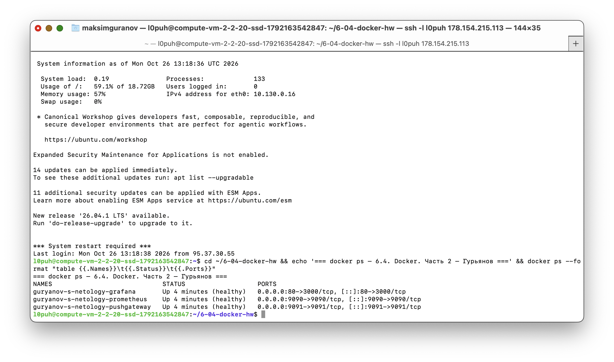
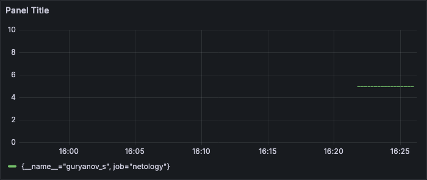
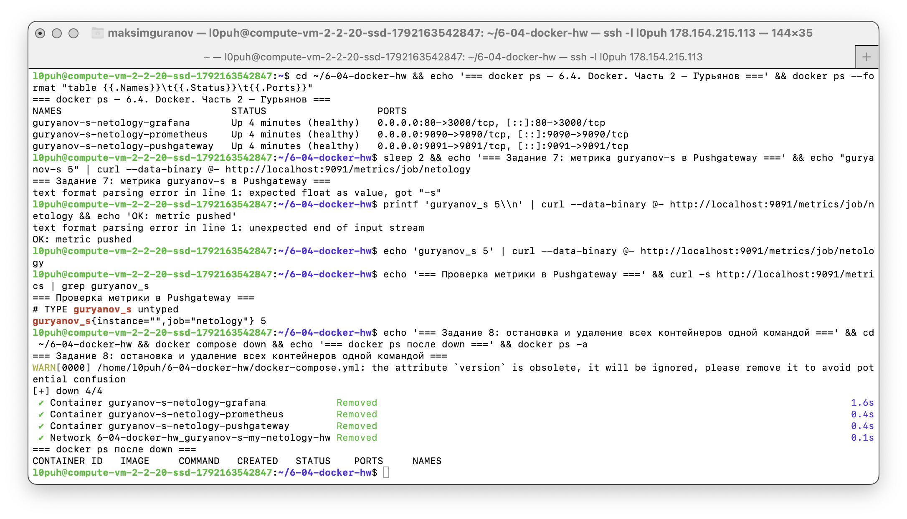

# 6.4. Docker. Часть 2 — Сергей Гурьянов

> Так как Docker разрешает только латиницу, цифры и дефисы, все имена выполнены транслитерацией:
> **Гурьянов С. → `guryanov-s`**, а для метрики Prometheus (где дефисы запрещены) — `guryanov_s`.

---

## Задание 1. Установка Docker Compose и его польза

Установил Docker Compose как плагин Docker одной командой:

```bash
curl -fsSL https://get.docker.com | sudo sh     # ставит docker + плагин compose
sudo usermod -aG docker $USER                   # чтобы работать без sudo
docker compose version                          # проверка установки
```

Docker Compose — это инструмент для описания и запуска многоконтейнерных приложений одним YAML-файлом: вместо того чтобы вручную писать длинные `docker run` с кучей флагов (сети, тома, порты, переменные окружения, порядок запуска), я один раз описываю всю инфраструктуру в `docker-compose.yml` и поднимаю её командой `docker compose up -d`, а сношу одной `docker compose down`. Для меня лично это означает, что любое своё приложение (база данных + backend + мониторинг из этого ДЗ) разворачивается на любой чистой машине за минуты и всегда одинаково, едет вместе с кодом в git, легко пересоздаётся при поломке и не «замусоривает» хост пакетами — то есть мой ноутбук и мои серверы превращаются в воспроизводимые окружения, которые можно менять и откатывать без страха.

---

## Задание 2. Первичный docker-compose.yml

Создан файл `docker-compose.yml` с первичными настройками (подсеть `10.5.0.0/16`, сеть названа `guryanov-s-my-netology-hw`):

```yaml
version: '3.8'

services:

volumes:

networks:
  guryanov-s-my-netology-hw:
    driver: bridge
    ipam:
      driver: default
      config:
        - subnet: 10.5.0.0/16
```

Дальше все сервисы из следующих заданий добавляются именно в эту сеть.

Структура проекта:

```
.
├── docker-compose.yml
├── grafana/
│   └── custom.ini          # логин guryanov-s, пароль netology
├── prometheus/
│   └── prometheus.yml      # конфиг из лекции (+rules.yml для задания 9*)
└── alertmanager/
    └── alertmanager.yml    # для задания 9*
```

---

## Задания 3–6. Prometheus, Pushgateway, Grafana

- **Задание 3:** контейнер `guryanov-s-netology-prometheus`, том `guryanov-s-prometheus-data` для данных и привязка конфига `./prometheus/prometheus.yml:/etc/prometheus/prometheus.yml:ro`, порт `9090:9090`.
- **Задание 4:** контейнер `guryanov-s-netology-pushgateway`, порт `9091:9091`.
- **Задание 5:** контейнер `guryanov-s-netology-grafana`, том `guryanov-s-grafana-data`, том с конфигом `./grafana/custom.ini:/etc/grafana/custom.ini:ro`, переменная окружения с путём до файла кастомных настроек `GF_PATHS_CONFIG=/etc/grafana/custom.ini` (в файле `admin_user = guryanov-s`, `admin_password = netology`), проброс `80:3000`.
- **Задание 6:** поочередность запуска через `depends_on` с проверкой здоровья (`condition: service_healthy`) — сначала pushgateway, затем prometheus, затем grafana; режим перезапуска `restart: always` (автостарт при падении и при перезагрузке докер-хоста); все сервисы в одной сети `guryanov-s-my-netology-hw`; запуск в detached режиме: `docker compose up -d`.

### Итоговый docker-compose.yml (целиком)

```yaml
version: '3.8'

volumes:
  prometheus-data:
    name: guryanov-s-prometheus-data
  grafana-data:
    name: guryanov-s-grafana-data

networks:
  guryanov-s-my-netology-hw:
    driver: bridge
    ipam:
      driver: default
      config:
        - subnet: 10.5.0.0/16

services:
  # ---------- Задание 4: Pushgateway ----------
  pushgateway:
    image: prom/pushgateway:v1.11.1
    container_name: guryanov-s-netology-pushgateway
    hostname: pushgateway
    restart: always
    networks:
      - guryanov-s-my-netology-hw
    ports:
      - "9091:9091"
    healthcheck:
      test: ["CMD-SHELL", "wget -q --spider http://localhost:9091/-/healthy || exit 1"]
      interval: 10s
      timeout: 5s
      retries: 3
      start_period: 15s

  # ---------- Задание 3: Prometheus ----------
  prometheus:
    image: prom/prometheus:v3.2.1
    container_name: guryanov-s-netology-prometheus
    hostname: prometheus
    restart: always
    networks:
      - guryanov-s-my-netology-hw
    depends_on:
      pushgateway:
        condition: service_healthy
    volumes:
      # том с данными
      - prometheus-data:/prometheus
      # том с конфигурацией
      - ./prometheus/prometheus.yml:/etc/prometheus/prometheus.yml:ro
    ports:
      - "9090:9090"
    healthcheck:
      test: ["CMD-SHELL", "wget -q --spider http://localhost:9090/-/healthy || exit 1"]
      interval: 10s
      timeout: 5s
      retries: 3
      start_period: 15s

  # ---------- Задание 5: Grafana ----------
  grafana:
    image: grafana/grafana:11.6.3
    container_name: guryanov-s-netology-grafana
    hostname: grafana
    restart: always
    networks:
      - guryanov-s-my-netology-hw
    depends_on:
      prometheus:
        condition: service_healthy
    environment:
      # путь до файла с кастомными настройками (файл лежит в томе)
      GF_PATHS_CONFIG: /etc/grafana/custom.ini
    volumes:
      # том с данными
      - grafana-data:/var/lib/grafana
      # том с конфигурацией (логин guryanov-s, пароль netology)
      - ./grafana/custom.ini:/etc/grafana/custom.ini:ro
    ports:
      # внешний доступ к 3000 с 80-го порта докер-сервера
      - "80:3000"
    healthcheck:
      test: ["CMD-SHELL", "curl -sf http://localhost:3000/api/health || exit 1"]
      interval: 10s
      timeout: 5s
      retries: 3
      start_period: 30s
```

Контент `grafana/custom.ini` (файл лежит в томе):

```ini
[security]

admin_user = guryanov-s
admin_password = netology
```

Контент `prometheus/prometheus.yml` (соответствует лекции: скрейп pushgateway):

```yaml
# my global config
global:
  scrape_interval: 15s # Set the scrape interval to every 15 seconds. Default is every 1 minute.
  evaluation_interval: 15s # Evaluate rules every 15 seconds. The default is every 1 minute.

# Alertmanager configuration
alerting:
  alertmanagers:
    - static_configs:
        - targets:
            # - alertmanager:9093

# Load rules once and periodically evaluate them according to the global 'evaluation_interval'.
rule_files:
  # - "first_rules.yml"
  # - "second_rules.yml"

# A scrape configuration containing exactly one endpoint to scrape:
# Here it's Prometheus itself.
scrape_configs:
  # The job name is added as a label `job=<job_name>` to any timeseries scraped from this config.
  # - job_name: "docker-server"
    # metrics_path defaults to '/metrics'
    # scheme defaults to 'http'.
  #   static_configs:
  #     - targets: ["172.17.0.1:9100"]

  - job_name: 'pushgateway'
    honor_labels: true
    static_configs:
      - targets: ["pushgateway:9091"]
```

Запуск в detached режиме:

```bash
docker compose up -d
docker compose ps
```



---

## Задание 7. Метрика, вход в Grafana, Data Source и график

1. Помещаю метрику `guryanov_s` со значением 5 в Pushgateway (дефис в имени метрики запрещён Prometheus, поэтому `guryanov_s`):

```bash
echo "guryanov_s 5" | curl --data-binary @- http://localhost:9091/metrics/job/netology
```

Проверка в Prometheus (Targets должен быть UP): http://<IP-сервера>:9090/targets

2. Логинюсь в Grafana по адресу http://<IP-сервера>/ (порт 80) — логин `guryanov-s`, пароль `netology`.

3. Data Source: **Home -> Connections -> Data sources -> Add data source -> Prometheus**, адрес `http://prometheus:9090`, Save & Test.

4. График: **Build a dashboard -> Add visualization -> Prometheus -> Select metric -> guryanov_s -> Apply**.



---

## Задание 8. Остановка и удаление контейнеров

```bash
docker compose down
```



---

## Задание 9* (дополнительное). Alertmanager

1. Контейнер `guryanov-s-netology-alertmanager`, том `guryanov-s-alertmanager-data`, конфиг из лекции `./alertmanager/alertmanager.yml:/etc/alertmanager/alertmanager.yml:ro`, порт `9093:9093`, одна сеть, `restart: always`, первый в очереди запуска.

2. Обновлённая конфигурация Prometheus: в `alerting.alertmanagers` раскомментирован адрес alertmanager, добавлен файл правил, чтобы событие гарантированно появилось в UI:

```yaml
# Alertmanager configuration
alerting:
  alertmanagers:
    - static_configs:
        - targets:
            - alertmanager:9093

rule_files:
  - "/etc/prometheus/rules.yml"
```

3. Правило постоянной учебной тревоги `prometheus/rules.yml`:

```yaml
groups:
  - name: netology-hw
    rules:
      - alert: NetologyHwAlert
        expr: vector(1)
        for: 0m
        labels:
          severity: warning
        annotations:
          summary: "Учебная тревога (homework alert)"
          description: "Метрика guryanov_s проверяется в Prometheus."
```

4. Запуск star-сценария (отдельный файл, включает все сервисы + alertmanager):

```bash
docker compose -f docker-compose-star.yml up -d
```

Событие: http://<IP-сервера>:9093 (alert `NetologyHwAlert` в статусе pending/firing).


---

## Задание 10* (дополнительное). Запуск на чистом железе

На чистом сервере (без предзагруженных образов) сценарий разворачивается так:

```bash
curl -fsSL https://get.docker.com | sudo sh          # 1. устанавливаю docker + compose
sudo usermod -aG docker $USER && newgrp docker
git clone https://github.com/<мой-логин>/my-netology-hw.git   # 2. забираю файлы проекта
cd my-netology-hw                                    #   (или переношу scp-ом)
docker compose up -d                                 # 3. образы подтянутся из registry автоматически
docker compose ps                                    # 4. проверяю статус
```

### Ответы на вопросы

**1. Опишите выполненный вами процесс развертывания сценария.**

Установил Docker Engine с плагином Compose на чистый сервер, перенес/склонировал файлы проекта (docker-compose.yml, конфиги prometheus, grafana, alertmanager) и, находясь в каталоге проекта, выполнил `docker compose up -d`. Ничего вручную не скачивалось: compose сам вытянул из Docker Hub образы prom/prometheus, prom/pushgateway, grafana/grafana, создал сеть `guryanov-s-my-netology-hw` с подсетью 10.5.0.0/16, именованные тома и контейнеры в правильной очередности (сначала дождался healthcheck у pushgateway, потом поднимал prometheus, и только потом grafana). После запуска проверил статус командами `docker compose ps` и `docker compose logs`, а работоспособность — джобой pushgateway в Prometheus и входом в Grafana.

**2. Как вы думаете, зачем может понадобиться такой способ развертывания?**

Такой способ нужен там, где важна воспроизводимость и скорость восстановления: при переезде на новый сервер/облако, восстановлении после аварии, тестировании одной и той же сборки в нескольких окружениях (dev/live), в CI/CD, где чистое окружение поднимается на каждый прогон тестов, и при передаче сценария коллегам — описание хранится в git и собирается из нуля по одной команде, без «ручных» шагов, про которые никто не помнит, и без накопившихся различий между машинами (фактически это IaC — «инфраструктура как код»).
